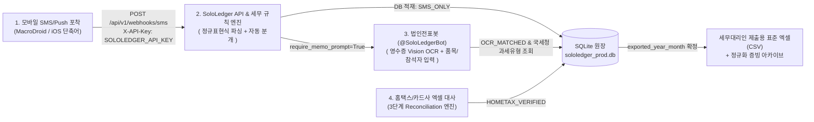

# SoloLedger 아키텍처 및 시스템 설계 명세서

> **원본 참조**: [Gemini 설계 검토 세션](https://share.gemini.google/M28P4cajbzfH)
> **공식 국문 명칭**: 실시간 법인카드 매입 대사 및 세무증빙 자동화 시스템 (1인 법인 전용 회계·경비 원장)
> **프로젝트 식별자**: `SoloLedger` (`solo-ledger`)

---

## 1. 프로젝트 개요 및 네임스페이스(Namespace) 표준

1인 운영 법인회사(대표이사 1인 단독 사용자) 환경에서 다단계 전자결재·부서 예산 통제 등 불필요한 엔터프라이즈 오버헤드를 제거하고, **외부 유료 중계 API 없이 100% 자체 구축(Zero-Cost Full In-house)** 으로 운영하는 경량 법인카드 원장 및 세무증빙 자동화 파이프라인입니다.

| 구성 요소 | 적용 규칙 | 표준 식별자 |
| :--- | :--- | :--- |
| **Git 저장소 (Repository)** | 소문자 `kebab-case` | `solo-ledger` (`https://github.com/kiyoubeo/solo-ledger.git`) |
| **Python 루트 패키지** | 소문자 `snake_case` | `sololedger` |
| **Docker 컨테이너 / 서비스** | 소문자 `kebab-case` | `sololedger-api`, `sololedger-bot` |
| **SQLite / PostgreSQL DB명** | 소문자 `snake_case` | `sololedger_prod.db` |
| **REST API 헤더 / 환경변수** | 대문자 `SCREAMING_SNAKE` | `SOLOLEDGER_API_KEY` |
| **텔레그램 봇 표시 이름** | 한글 직관 명칭 + 영문 ID | `법인전표봇 (@SoloLedgerBot)` |

---

## 2. 4단계 경량 자동화 파이프라인 아키텍처

### 2.1 실시간 수집 경로 (SMS / Push Webhook)
- 대표자 스마트폰으로 수신되는 법인카드 승인·취소 문자(SMS)를 Android(MacroDroid/Tasker) 또는 iOS(단축어 즉시 실행)로 포착하여 `POST /api/v1/webhooks/sms`로 전송.
- 국내 주요 카드사(신한, KB국민, 현대, 삼성, 하나, 우리, 기업/BC, NH농협)의 단일 행 / 다중 행 / 승인 취소 포맷을 **필드별 독립 추출기(`parse_korean_card_sms`)** 로 파싱.
- 동일 거래 중복 수신에 대한 멱등성(Idempotency) 검증 후 1차 원장(`SMS_ONLY`) 생성.

### 2.2 영수증 이미지 및 지출 목적 결합 (Chatbot + Vision OCR + 국세청 API)
- 온라인 쇼핑몰(PG사) 품목 소명 또는 식음료(복리후생비 vs 기업업무추진비) 구분이 필요한 결제 건은 `@SoloLedgerBot`이 즉시 대표자에게 알림 발송.
- 영수증 사진 또는 주문 캡처본 수신 시 Vision LLM으로 사업자등록번호, 합계 금액, 세부 품목(`line_items_json`) 추출 및 SHA-256 중복 업로드 차단.
- 추출된 사업자등록번호는 공공데이터포털 **국세청 사업자등록 상태조회 API**를 통해 일반·간이·면세 및 휴·폐업 여부를 판별하고 `merchants` 테이블에 30일간 캐싱.

### 2.3 1인 법인 맞춤형 세무 분류 규칙 엔진 (`tax_classification_rules`)
1. **전자상거래/PG사 (`쿠팡|네이버페이|알리익스프레스|이니시스|토스페이먼츠|카카오페이`)**: 기본 `830 소모품비` 매핑 및 실제 구매 품목 소명 알림(`require_memo_prompt=True`) 발송. 증빙 파일명을 `YYYYMMDD_가맹점_계정과목_품목_금액.확장자` 형태로 정규화.
2. **업무용승용차 관련 비용 (`주유소|에너지|스피드메이트|오토큐|하이패스|주차`)**: `822 차량유지비` 자동 분류, 부가세 매입세액 강제 불공제(`NON_DEDUCTIBLE`, 사유 `PASSENGER_CAR`), 연간 1,500만 원 특례 한도 추적 플래그(`is_vehicle_expense=True`) 설정.
3. **SaaS / 클라우드 구독 (`GITHUB|OPENAI|GOOGLE|AWS|클라우드`)**: `831 지급수수료` 자동 분류.
4. **식음료/카페 (`스타벅스|컴포즈|맥도날드` 등)**: 기본 `811 복리후생비` 분류 후 단독 식사 vs 외부 거래처 미팅(`813 기업업무추진비`, 불공제 `ENTERTAINMENT` + 참석자 기록) 확인 프롬프트 발송.

### 2.4 정기 정산 및 3단계 자동 대사(Reconciliation) 알고리즘
월말/분기별 홈택스 또는 카드사 매입 내역 엑셀(CSV) 업로드 및 영수증 OCR 매칭 시 다음 우선순위로 원장을 병합(Merge)합니다:
- **1순위 (승인번호 정확 일치)**: `approval_no`가 존재하고 `total_amount`가 일치하는 레코드와 즉시 결합.
- **2순위 (결제금액 + 시간 오차 범위 일치)**: 승인번호가 없는 `SMS_ONLY` 원장 중 `total_amount`가 일치하고 `transacted_at` 차이가 전후 10분 이내인 레코드를 찾아 `biz_reg_no`와 `approval_no` 보완.
- **3순위 (신규 원장 강제 생성)**: 매칭되는 기존 레코드가 없을 경우 신규 행을 삽입(`INSERT`)하여 누락 방지.

---

## 3. 데이터베이스 핵심 테이블 구조 (`sql/schema.sql`)

1. **`merchants`**: 가맹점 사업자등록번호(`biz_reg_no` PK), 가맹점명, 국세청 과세유형(`tax_type_code`), 영업상태(`biz_status`), PG사 여부(`is_pg_provider`), 기본 계정과목(`default_account_code`), 최종 검증일시(`nts_verified_at`).
2. **`card_transactions`**: 거래 원장 고유 ID(`tx_id` PK), 카드 끝 4자리(`card_last4`), 승인번호(`approval_no`), 거래일시(`transacted_at`), 원본 가맹점명(`raw_merchant_name`), 사업자번호(`biz_reg_no` FK), 총액(`total_amount`), 공급가액(`supply_value`), 부가세(`vat_amount`), 계정코드/명(`account_code`, `account_name`), 공제구분(`vat_deduction_type`), 불공제사유(`non_deduct_reason`), 업무용승용차 여부(`is_vehicle_expense`), 적요/참석자(`counterparty_info`), 대사상태(`reconcile_status`), 세무사 출력연월(`exported_year_month`).
3. **`receipt_ocr_metadata`**: 영수증 ID(`receipt_id` PK), 원장 ID(`tx_id` FK), 수집채널(`source_channel`), 원본/아카이브 파일명(`original_file_path`, `archived_file_name`), 파일 해시(`file_hash_sha256` UNIQUE), OCR 추출 사업자번호/금액/품목JSON/원본응답/신뢰도.
4. **`tax_classification_rules`**: 규칙 ID(`rule_id` PK), 우선순위(`priority`), 매칭 필드(`match_field`), 정규식 패턴(`match_pattern`), 대상 계정코드/명(`target_account_code`, `target_account_name`), 강제 불공제 여부/사유(`force_non_deductible`, `non_deduct_reason`), 차량비용 플래그(`set_vehicle_flag`), 메모 프롬프트 여부(`require_memo_prompt`), 활성화 여부(`is_active`).
