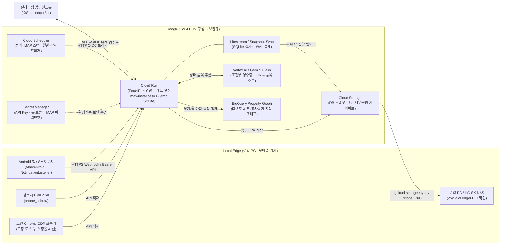
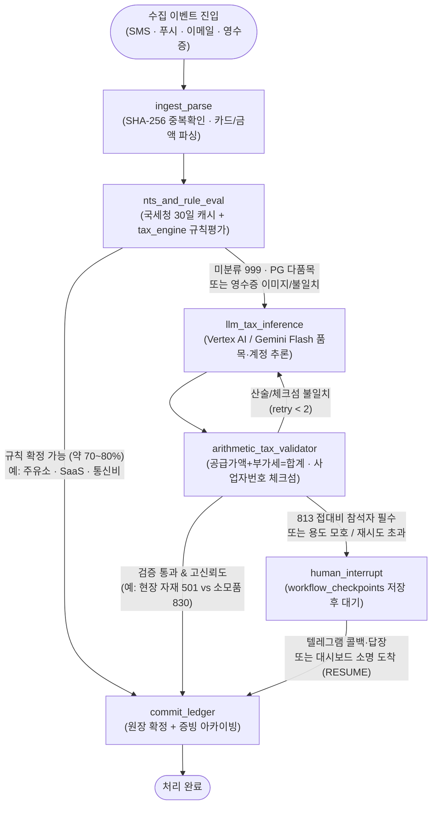
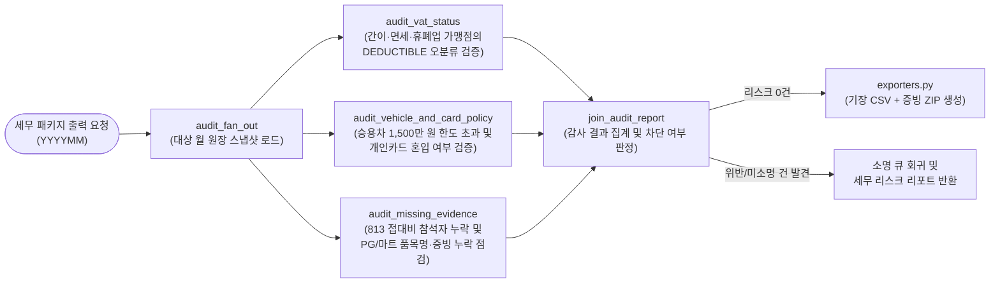

# SoloLedger 그래프 엔지니어링 & Google Cloud 하이브리드 전환 설계서

> **문서 버전**: `v1.0` (작성일: 2026-11-21)
> **대상 시스템**: `SoloLedger` (`v1.2.0` 기준 확장 설계)
> **연관 문서**: [docs/ARCHITECTURE_SPEC.md](./ARCHITECTURE_SPEC.md) · [docs/DEVELOPMENT_PLAN.md](./DEVELOPMENT_PLAN.md)
> **원격 저장소**: `https://github.com/kiyoubeo/solo-ledger.git` (`main`)

---

## 1. 설계 목적 및 3대 핵심 원칙

본 문서는 기존 로컬·단독 실행형(`SoloLedger.exe` + Android 앱)으로 완성된 `SoloLedger v1.2.0`을 기반으로, **① 그래프 엔지니어링(Graph Engineering) 기반의 결정론적 AI/세무 워크플로 고도화**와 **② Google Cloud 서버리스 하이브리드(`구성 B 보완형`) 서비스 전환**을 단계적으로 적용하기 위한 아키텍처 기준서입니다.

1. **무비용·초저비용 운영 (Zero/Near-Zero Cost)**
   - Google Cloud 무료 티어(`Cloud Run`, `Cloud Storage`, `Cloud Scheduler`, `BigQuery`)를 중심으로 인프라 고정비를 0원~수천 원 수준으로 억제합니다.
   - 전표의 70~80%는 기존 정규식 규칙과 국세청 30일 캐시 노드로 즉시 확정(LLM 비용 0원)하고, 미분류(`999`)·PG 다품목·영수증 이미지 등 모호한 건만 조건부 분기로 AI 노드를 호출합니다.
2. **단일 실행파일(`SoloLedger.exe`) 및 로컬 호환성 100% 유지**
   - `Neo4j` 같은 별도 유료·고중량 그래프 DB 컨테이너나 의존성이 큰 외부 오케스트레이션 프레임워크를 도입하지 않습니다.
   - 코어 그래프 엔진은 표준 Python + `Pydantic` 상태 모델 + SQLite 체크포인트(`workflow_checkpoints`)로 내재화하여, 클라우드 서버(`Cloud Run`)와 로컬 PC 데스크톱 앱(`SoloLedger.exe`) 양쪽에서 동일하게 동작합니다.
3. **세무 리스크 원천 방어 (Tax Compliance by Design)**
   - 산술 정합성(`공급가액 + 부가세 = 합계`), 사업자등록번호 체크섬, 국세청 과세유형(일반/간이/면세/휴폐업), 접대비(`813 기업업무추진비`) 참석자 기록, PG사 품목 소명을 그래프 상태 전이 조건으로 강제합니다.

---

## 2. Google Cloud 전환(`구성 B 보완형`) 아키텍처

### 2.1 전체 하이브리드 토폴로지 (Cloud Hub + Local Edge)

### 2.2 `구성 B` 전환 시 3대 기술 병목과 보완 해법

기존 로컬 코드베이스를 수정 없이 `Cloud Run`에 배포할 경우 발생하는 3가지 구조적 병목을 다음과 같이 해결합니다.

#### 병목 1. `Cloud Run` + `SQLite` 파일 잠금 충돌 방지
- **원인**: [db.py](../src/sololedger/db.py)는 로컬 파일 `sololedger_prod.db`에 직접 입출력합니다. `Cloud Storage` FUSE 볼륨 마운트는 객체 스토리지 에뮬레이션이므로 POSIX 바이트 범위 잠금(Byte-range lock)을 지원하지 않습니다([nas_sync.py](../src/sololedger/nas_sync.py#L21-L25)의 ipDISK `Z:\` 드라이브 제약과 동일). 다중 인스턴스가 동일 파일에 쓰기를 시도하면 DB 손상이 발생할 수 있습니다.
- **해법**:
  1. `Cloud Run` 서비스의 동시 인스턴스 상한을 `max-instances=1`로 고정하여 단일 쓰기 주체를 보장합니다.
  2. SQLite 원장 파일은 컨테이너 내부 고속 로컬 디스크(`/tmp/sololedger_prod.db`)에서 구동합니다.
  3. **컨테이너 기동 시 복원 + 실시간 복제**: 컨테이너 시작 시 `Cloud Storage`에서 최신 DB 스냅샷을 `/tmp`로 내려받고, 운영 중에는 `Litestream` 사이드카(또는 쓰기 트랜잭션 직후 비동기 스냅샷 업로드)로 `Cloud Storage`에 즉시 복제합니다.

| 비교 항목 | 구성 A: 소형 VM (`Compute Engine`) | 구성 B 보완형: 서버리스 (`Cloud Run` + `Litestream` + `GCS`) |
| :--- | :--- | :--- |
| **핵심 구성** | `e2-micro` VM + 영구 디스크 + `docker-compose.yml` | `Cloud Run (max-instances=1)` + `Cloud Storage` + `Secret Manager` |
| **SQLite 영속성** | VM 영구 디스크에 직접 저장 (구조 변경 없음) | 컨테이너 `/tmp` 실행 + `Litestream`으로 `GCS` 실시간 복제 |
| **HTTPS / 운영 관리** | 리버스 프록시(Caddy/Nginx) 및 OS 보안 패치 직접 관리 | **관리형 HTTPS 자동 발급**, OS 패치 불필요, 유휴 시 컴퓨팅 0원 |
| **권장 적용** | 빠른 단순 이전 우선 시 | **장기 운영 표준 (Zero-Ops + 무료 티어 극대화)** |

#### 병목 2. Scale-to-Zero와 백그라운드 이메일 폴링 루프 분리
- **원인**: [api.py](../src/sololedger/api.py#L91-L110)의 `_background_email_watcher_loop()`는 FastAPI 수명주기 내부에서 `while True` 루프로 동작합니다. `Cloud Run`은 HTTP 요청이 없으면 CPU를 동결(Throttling)하므로 백그라운드 루프가 멈추게 됩니다.
- **해법**:
  - 환경변수 `SOLOLEDGER_CLOUD_MODE=true` 활성화 시 FastAPI 내부 무한 루프를 비활성화합니다.
  - 대신 **`Cloud Scheduler`**가 5~10분 주기로 `POST /api/v1/cloud/jobs/email-sync` 엔드포인트를 호출하도록 구성하여, 요청 시점에만 컨테이너를 깨워 IMAP 주문/결제 메일을 수집하고 즉시 유휴 상태로 복귀합니다.

#### 병목 3. 클라우드 허브(Cloud Hub)와 로컬 엣지(Local Edge) 역할 분리
- **원인**: 갤럭시 USB ADB 문자 추출([phone_adb.py](../src/sololedger/phone_adb.py))과 로컬 Chrome CDP 쿠팡·쇼핑몰 크롤러([scraper_service.py](../src/sololedger/scraper_service.py))는 사용자의 물리적 스마트폰 USB 연결 및 로컬 로그인 브라우저 세션에 의존하며, 쇼핑몰은 클라우드 데이터센터 IP 대역의 자동 접속을 차단합니다.
- **해법**:
  - **Cloud Hub (`Cloud Run` + `Cloud Storage` + `Secret Manager`)**: 24시간 고정 HTTPS 주소로 Android 푸시/SMS 웹훅 수신, `@SoloLedgerBot` 양방향 소명, 정기 IMAP 주문메일 파싱, 웹/모바일 원장 조회 및 세무 패키지 생성 담당.
  - **Local Edge (`SoloLedger.exe` / 로컬 PC)**: USB ADB 문자 수집, Chrome CDP 쇼핑몰 주문내역 크롤링 후 클라우드 원장 API로 업로드를 수행하는 엣지 수집기 역할 담당.
  - **로컬 PC / NAS Pull 이중 백업**: 클라우드에서 로컬 `Z:\` 드라이브로 직접 Push하는 대신(공유기 포트포워딩 불필요), 로컬 PC 또는 NAS 스케줄러에서 하루 1회 `gcloud storage rsync` 또는 `rclone`으로 `Cloud Storage` → `Z:\SoloLedger` 단방향 동기화(Pull)를 수행합니다.

---

## 3. 그래프 엔지니어링(Graph Engineering) 상세 설계

### 3.1 코어 경량 그래프 런타임 (`workflow_graph.py`)

무거운 외부 의존성 없이 `SoloLedger` 내부에 선언적 상태 그래프 실행기를 구축합니다.

- **`GraphState` (공유 상태 모델)**: `Pydantic` 기반으로 거래 원장 스냅샷, OCR 추출 결과, 검증 오류 목록, 재시도 횟수(`retry_count`), 현재 노드 위치(`current_node`), 중단 사유(`interrupt_reason`)를 불변 스키마로 관리합니다.
- **`Node` (실행 노드)**: 결정론적 Python 함수(정규식 분류, 국세청 API 조회, 산술 검증) 또는 비동기 AI 호출(Gemini Vision/Flash 추론)을 동일한 인터페이스로 추상화합니다.
- **`ConditionalEdge` (조건부 라우팅 & 순환)**: 노드 실행 결과(`state`)를 평가하여 다음 노드(성공 확정, 재검증 순환 `Cycle`, 또는 사용자 중단 `Interrupt`)로 분기합니다.
- **`SQLite Checkpointer` (`workflow_checkpoints` 테이블)**: 사용자 소명이 필요한 지점(`human_interrupt`)에서 전체 `GraphState` JSON을 SQLite에 저장하고 즉시 응답을 반환합니다. `Cloud Run` 인스턴스가 유휴 종료되더라도, 추후 텔레그램 버튼/답장이나 웹 대시보드 입력이 도착하면 저장된 체크포인트에서 `RESUME` 실행을 이어갑니다.

### 3.2 전표 처리·소명 상태 그래프 (`Receipt & PG Resolution State Graph`)

- **비용·성능 통제 효과**:
  - 기존 확정 규칙으로 판별 가능한 전표는 AI 노드를 전혀 타지 않아 **LLM 호출 비용 0원**을 유지합니다.
  - AI 추론 노드를 거치더라도 `arithmetic_tax_validator` 노드가 공급가액·부가세 합계 오류나 전화번호를 사업자번호로 오인한 환각(Hallucination)을 즉시 탐지하여 최대 2회까지 재추출 순환(`Cycle`)을 강제합니다.
  - `813 기업업무추진비` 참석자 기재나 PG 결제 용도 확인이 필요한 경우 `human_interrupt`에서 안전하게 멈추므로 잘못된 자동 확정을 원천 차단합니다.

### 3.3 세무사 제출 전 사전 세무 감사 병렬 그래프 (`Pre-Export Tax Audit Graph`, `audit_graph.py`)

[exporters.py](../src/sololedger/exporters.py)에서 월별/분기별 세무사 제출용 `SoloLedger_세무증빙_{YYYYMM}.zip` 패키지를 생성하기 직전, 다수의 감사 노드를 **병렬 팬아웃(`Fan-out`)**으로 동시 실행하고 **조인(`Join`)**하여 세무 리스크를 차단합니다.

### 3.4 다년도 세무·공사원가 지식 그래프 (`BigQuery Property Graph`)

실시간 트랜잭션(OLTP) 원장은 계속 경량 SQLite로 처리하되, 월/분기 마감 후 확정된 원장 데이터를 Google Cloud `BigQuery`에 적재하여 표준 SQL 기반 속성 그래프(`CREATE PROPERTY GRAPH`)를 구성합니다.

- **노드(Node) 테이블**: `Merchant`(가맹점), `CardTransaction`(법인카드 전표), `OrderLineItem`(주문 상세 품목), `AccountCategory`(계정과목: `501 원재료비`, `511 외주비`, `811 복리후생비`, `813 기업업무추진비`, `822 차량유지비`, `830 소모품비`), `ConstructionSite`(공사현장/프로젝트).
- **엣지(Edge) 테이블**:
  - `PURCHASED_AT` (`CardTransaction` → `Merchant`)
  - `CONTAINS_ITEM` (`CardTransaction` → `OrderLineItem`)
  - `CLASSIFIED_AS` (`CardTransaction` → `AccountCategory`)
  - `ATTRIBUTED_TO` (`CardTransaction` → `ConstructionSite`)
- **활용 시나리오**:
  1. **다중 홉(Multi-hop) GQL 계정 추천**: 신규 온라인 판매자나 PG사 결제 건이라도 구매 품목 키워드와 공사 현장 맥락이 과거 확정 그래프와 연결되면 `501 원재료비` vs `830 소모품비` 추천 정확도를 높입니다.
  2. **세무 조사 대비 이상 패턴 탐지**: 동일 가맹점에서 특정 시점에 `811 복리후생비`와 `813 기업업무추진비`가 혼재되거나, 주말·심야 시간대 특정 업종 지출이 집중되는 패턴을 GQL 경로 탐색으로 조기 식별합니다.

---

## 4. 단계별 전환 로드맵 (Phase 8 ~ Phase 10)

| 단계 | 목표 버전 | 핵심 구현 범위 | 주요 신규 산출물 | 검증 기준 (`pytest`) |
| :--- | :---: | :--- | :--- | :--- |
| **Phase 8** | `v1.3.0` | 코어 경량 상태 그래프 엔진(`GraphState`, 체크포인트 중단/재개, 산술·체크섬 재검증 순환 루프) 및 세무 마감 사전 감사 병렬 그래프 | `workflow_graph.py`, `audit_graph.py`, `sql/schema.sql` (`workflow_checkpoints`) | `tests/test_workflow_graph.py` |
| **Phase 9** | `v1.4.0` | Google Cloud 서버리스 하이브리드 전환(`StorageBackend` 로컬/GCS 추상화, `Cloud Run` `max-instances=1` + `Litestream`, `Cloud Scheduler` 잡 엔드포인트, NAS Pull 스크립트) | `storage_backend.py`, `cloud_sync.py`, `deploy/cloudrun.yaml` | `tests/test_cloud_storage.py` |
| **Phase 10** | `v1.5.0` | `BigQuery Property Graph` 다년도 세무·공사원가 지식 그래프 적재기 및 GQL 리스크 감사 리포트 연동 | `bq_graph_exporter.py`, `sql/bigquery_property_graph.sql` | `tests/test_bq_graph.py` |

> **실행 순서 권장안**:
> 1. **Phase 8 먼저 완료**: 클라우드 인프라 없이 로컬(`SoloLedger.exe` 및 `pytest`)에서 그래프 오케스트레이션과 사전 세무 감사 로직의 100% 결정론적 안정성을 먼저 검증합니다.
> 2. **Phase 9로 클라우드 전환**: 스토리지 추상화와 `Cloud Scheduler` 트리거를 적용하여 24시간 서버리스 허브를 가동합니다.
> 3. **Phase 10으로 데이터 지능화**: 1년 치 이상 원장이 축적되는 시점에 `BigQuery Property Graph`를 활성화합니다.

---

## 5. 월간 예상 운영 비용 시뮬레이션 (1인 법인 기준)

| Google Cloud 리소스 | 1인 법인 월 예상 사용량 | 무료 티어(Always Free) 범위 | 예상 월 비용 |
| :--- | :--- | :--- | :---: |
| **Cloud Run** | 일 수십 건 웹훅 + 10분 주기 스케줄러 호출 | 월 200만 요청, 18만 vCPU-초, 36만 GiB-초 무료 | **0원** |
| **Cloud Storage** | SQLite 스냅샷 + 영수증 증빙 누적 1~5 GB | `us-central1` 기준 5GB 무료 (서울 리전 사용 시 소액) | **0원 ~ 500원** |
| **Cloud Scheduler** | 이메일 스캔 + 일일 백업 + 월말 감사 (잡 3개) | Google 계정당 매월 3개 작업(Job) 무료 | **0원** |
| **Secret Manager** | API 키·봇 토큰·앱 비밀번호 6개 내외 | 활성 시크릿 버전 6개, 월 1만 건 액세스 무료 | **0원** |
| **Artifact Registry** | 컨테이너 이미지 1~2개 보관 (< 0.5 GB) | 월 0.5 GB 스토리지 무료 | **0원** |
| **Vertex AI / Gemini Flash** | 규칙 미매칭 모호 전표·영수증 OCR만 조건부 호출 | 사용량 기반 종량제 (월 수십 건 기준) | **수백 원 이내** |
| **BigQuery (Phase 10)** | 연간 원장 수 MB 적재 및 분기별 GQL 감사 | 매월 10 GB 저장, 1 TB 쿼리 무료 | **0원** |

- **총 예상 유지비**: **월 0원 ~ 2,000원 미만** (기존 유료 스크래핑 중계 API 대비 사실상 무비용 운영 원칙 충족)
