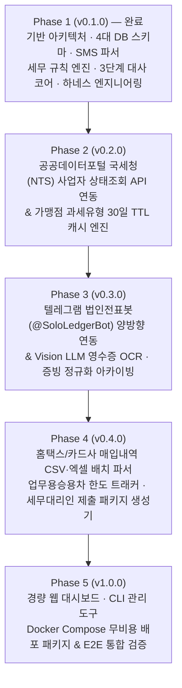

# SoloLedger 마스터 개발 계획서 (Development Plan)

> **문서 버전**: `v1.0` (작성일: 2026-10-27)
> **대상 시스템**: `SoloLedger` (`solo-ledger`) — 1인 법인 전용 회계·경비 원장 및 실시간 법인카드 세무증빙 자동화 시스템
> **설계 기준 문서**: [docs/ARCHITECTURE_SPEC.md](./ARCHITECTURE_SPEC.md)
> **원격 저장소**: `https://github.com/kiyoubeo/solo-ledger.git` (`main`)

---

## 1. 개발 목표 및 핵심 원칙

1. **100% 자체 구축 및 무비용 운영 (Zero-Cost Full In-house)**
   - 유료 스크래핑 중계 API(쿠콘, 하이픈 등)나 상용 경비 SaaS 구독료 없이, **모바일 SMS Webhook + 텔레그램 봇(`@SoloLedgerBot`) + 멀티모달 Vision LLM + 공공데이터포털 국세청 무료 API + 홈택스 엑셀 대사**의 경량 파이프라인으로 완결합니다.
2. **1인 법인 세무 리스크 원천 방어 (Tax Compliance by Design)**
   - 대표이사 단독 식사(`811 복리후생비`) vs 외부 미팅(`813 기업업무추진비`·매입세액 불공제·참석자 기록) 구분, 업무용승용차 관련 비용(`822 차량유지비`·매입세액 불공제·연간 1,500만 원 한도 추적), 온라인 쇼핑몰(PG사) 결제 품목 소명 및 증빙 파일 정규화를 시스템 규칙으로 강제합니다.
3. **하네스 엔지니어링 기반 무결성 보장 (Harness-Driven Development)**
   - 모든 기능 개발 단위는 [scripts/harness.ps1](../scripts/harness.ps1)을 통해 **① 구문 컴파일(`compileall`) → ② 정적 분석(`ruff check`) → ③ DB 스키마 무결성 검증 → ④ 단위·통합 테스트(`pytest`) → ⑤ 변경 로그 기록(`CHANGELOG.md`, `CLAUDE.md`, `logs/dev_changes.jsonl`) → ⑥ Git 커밋 및 `origin/main` 푸시**의 6단계 사이클로 완결됩니다.

---

## 2. 전체 개발 단계(Phase) 로드맵



| 단계 | 목표 버전 | 핵심 개발 범위 | 주요 산출물 (`src/sololedger/`) | 예상 공수 | 현재 상태 |
| :--- | :---: | :--- | :--- | :---: | :---: |
| **Phase 1** | `v0.1.0` | DB 스키마, 한국어 카드 SMS 파서, 세무 분류 엔진, 3단계 대사 코어, FastAPI 웹훅, 하네스 엔지니어링 | `db.py`, `sms_parser.py`, `tax_engine.py`, `reconciler.py`, `api.py`, `scripts/harness.ps1` | 8h | **완료 (`PASSED`)** |
| **Phase 2** | `v0.2.0` | 국세청 사업자등록 상태조회 API 연동, 사업자번호 체크섬 검증, `merchants` 30일 캐시, 과세유형별 공제 자동 전환 | `nts_client.py`, `merchant_service.py` | 8h | **완료 (`PASSED`)** |
| **Phase 3** | `v0.3.0` | `@SoloLedgerBot` 양방향 콜백/답장 처리, Vision LLM 영수증·주문내역 OCR, SHA-256 중복 방지, 증빙 파일 정규화 보관 | `telegram_bot.py`, `ocr_engine.py`, `archiver.py` | 14h | **완료 (`PASSED`)** |
| **Phase 4** | `v0.4.0` | 홈택스·카드사 엑셀/CSV 파서, 외화 결제 확정, 업무용승용차 1,500만 원 한도 집계, 세무사 제출용 CSV+ZIP 번들 생성기 | `importers.py`, `exporters.py`, `vehicle_tracker.py` | 12h | **완료 (`PASSED`)** |
| **Phase 5** | `v1.0.0` | 경량 웹 대시보드(미분류·소명 관리/파일 업로드), 운영 CLI, Docker Compose 배포 및 백업 자동화 | `dashboard.py`, `cli.py`, `docker-compose.yml` | 8h | 예정 |

---

## 3. 단계별 상세 개발 명세 및 검증 계획

### Phase 1: 기반 아키텍처, 코어 원장 엔진 & 하네스 엔지니어링 (`v0.1.0` — 완료)
- **구현 완료 항목**:
  - [sql/schema.sql](../sql/schema.sql): `merchants`, `card_transactions`, `receipt_ocr_metadata`, `tax_classification_rules` 4대 테이블 및 인덱스, 초기 세무 분류 규칙 4종 시드 데이터
  - [src/sololedger/sms_parser.py](../src/sololedger/sms_parser.py): 신한·KB국민·현대·삼성·하나·우리·기업/BC·NH농협 단일행/다중행/승인취소/누적금액 제거/승인번호 추출 파서
  - [src/sololedger/tax_engine.py](../src/sololedger/tax_engine.py): 우선순위 기반 정규식 세무 규칙 평가 및 공급가액·부가세 자동 분리 계산
  - [src/sololedger/reconciler.py](../src/sololedger/reconciler.py): 1순위(승인번호+금액) → 2순위(금액+10분 시간창) → 3순위(신규 강제 생성) 대사 엔진
  - [src/sololedger/api.py](../src/sololedger/api.py): `POST /api/v1/webhooks/sms`, `POST /api/v1/reconcile`, `GET /api/v1/transactions`, `GET /health`
  - [scripts/harness.ps1](../scripts/harness.ps1) 및 [.agents/hooks.json](../.agents/hooks.json): 4단계 자동 검증, 변경 이력 3중 로깅, 미커밋/미푸시 종료 방지 가드
- **검증 현황**: `pytest` 21개 테스트 케이스 통과 (`PASSED`)

---

### Phase 2: 국세청(NTS) 사업자 상태조회 연동 및 가맹점 캐시 고도화 (`v0.2.0`)
- **목적**: 가맹점 사업자등록번호를 기반으로 일반과세자·간이과세자·면세사업자·휴폐업 여부를 자동 판별하여 부가세 매입세액 부당공제 리스크를 제거하고, 30일 캐싱으로 외부 API 호출을 최소화합니다.
- **세부 구현 과제**:
  1. **사업자등록번호 유효성 및 정규화 유틸리티 (`nts_client.py`)**
     - 하이픈(`-`) 및 공백 제거, 10자리 숫자 형식 검증 및 대한민국 사업자등록번호 체크섬(가중치 `1, 3, 7, 1, 3, 7, 1, 3, 5`) 검증 함수 구현.
  2. **공공데이터포털 국세청 상태조회 API 비동기 클라이언트 (`nts_client.py`)**
     - 환경변수 `NTS_API_SERVICE_KEY` 연동 (`https://api.odcloud.kr/api/nts-businessman/v1/status`).
     - 국세청 응답 코드(`b_stt_cd`: `01` 계속 / `02` 휴업 / `03` 폐업, `tax_type_cd`: `01` 일반 / `02` 간이 / `03` 과특 / `04` 면세 등)를 내부 표준 코드(`GENERAL`, `SIMPLIFIED`, `EXEMPT`, `UNREGISTERED` 및 `ACTIVE`, `SUSPENDED`, `CLOSED`)로 변환.
     - API 키 미설정 개발 환경에서도 동작하도록 결정론적 Local Fallback / Mock 어댑터 지원.
  3. **`merchants` 30일 TTL 캐시 및 원장 자동 반영 서비스 (`merchant_service.py`)**
     - `merchants.nts_verified_at`이 현재 시각 기준 30일 이내면 DB 캐시 즉시 반환, 경과 또는 미존재 시 국세청 API 호출 후 Upsert.
     - 가맹점의 `default_account_code`가 지정되어 있는 경우 반복 방문 시 최우선 계정 매핑 지원.
     - `POST /api/v1/merchants/verify` 엔드포인트 추가 및 대사/OCR 파이프라인 자동 연동.
- **하네스 검증 테스트 (`tests/test_nts_client.py`)**:
  - 사업자번호 체크섬 정상/오류 케이스 검증
  - 30일 이내 캐시 히트 시 외부 HTTP 호출 미발생 검증
  - 간이과세자·면세·폐업자 판정 시 원장 `vat_deduction_type`이 `NON_DEDUCTIBLE`(사유 `SIMPLIFIED_TAX`) 또는 `EXEMPT`로 자동 전환되는지 검증

---

### Phase 3: 텔레그램 법인전표봇(`@SoloLedgerBot`) 양방향 연동 및 Vision OCR 파이프라인 (`v0.3.0`)
- **목적**: 결제 직후 메신저에서 10초 내에 용도(단독 식사 vs 거래처 미팅)와 품목(쿠팡 등 PG 결제)을 확정하고, 영수증 사진을 Vision LLM으로 파싱·정규화 보관합니다.
- **세부 구현 과제**:
  1. **증빙 이미지 해싱 및 정규화 아카이빙 모듈 (`archiver.py`)**
     - 업로드 파일의 SHA-256 해시(`file_hash_sha256`) 계산 → `receipt_ocr_metadata` 중복 검사로 동일 영수증 재업로드 원천 차단 (`409 Conflict` / 중복 안내).
     - 정규화 파일명 생성기: `{YYYYMMDD}_{가맹점명}_{계정과목명}_{주요품목}_{금액}.{ext}` (파일시스템 금지 문자 자동 정제).
  2. **멀티모달 Vision LLM 영수증·주문내역 파서 (`ocr_engine.py`)**
     - 영수증 이미지 또는 온라인 쇼핑몰 캡처본에서 `biz_reg_no`, `merchant_name`, `approval_no`, `transacted_at`, `total_amount`, `supply_value`, `vat_amount`, `line_items` 배열(`[{"item": "...", "qty": 1, "price": ...}]`), `confidence`를 JSON 스키마로 추출.
     - 추출 결과를 `receipt_ocr_metadata`에 저장하고 `reconcile_single_item`(`reconcile_source='OCR_MATCHED'`)을 호출하여 기존 `SMS_ONLY` 원장과 자동 결합.
     - 카드 승인 원장 금액과 영수증 OCR 금액 불일치 시 경고 플래그 반환.
  3. **텔레그램 봇 양방향 웹훅 및 API 엔드포인트 (`telegram_bot.py`, `api.py`)**
     - `POST /api/v1/webhooks/telegram`:
       - **인라인 콜백 쿼리 처리**: 식음료 결제 알림의 `[단독 식사(복리후생비)]` 선택 시 `811 복리후생비` + `DEDUCTIBLE` 확정, `[거래처 미팅(기업업무추진비)]` 선택 시 `813 기업업무추진비` + `NON_DEDUCTIBLE`(`ENTERTAINMENT`) 전환 및 참석자 입력 안내.
       - **텍스트 답장(Reply) 처리**: 전표 알림 메시지에 답장으로 `"모니터암 구매 (비품)"` 또는 `"A사 김철수 대표 미팅"` 입력 시 해당 `tx_id`의 `counterparty_info` 및 계정과목 업데이트.
       - **사진(Photo/Document) 수신 처리**: 영수증 이미지 다운로드 → `archiver` + `ocr_engine` 실행 → 매칭 결과 답장 전송.
     - `POST /api/v1/receipts/upload`: 웹/API 직접 영수증 업로드 엔드포인트 제공.
- **하네스 검증 테스트 (`tests/test_ocr_and_bot.py`)**:
  - 동일 이미지 SHA-256 중복 업로드 차단 검증
  - 정규화 파일명 생성 규칙(`20261020_쿠팡_소모품비_모니터암_45000.jpg`) 검증
  - 텔레그램 인라인 콜백(복리후생비 ↔ 기업업무추진비 불공제 전환) 및 메모 업데이트 검증
  - Vision OCR 추출 결과와 `SMS_ONLY` 원장 간 자동 매칭 검증

---

### Phase 4: 홈택스·카드사 엑셀(CSV) 대사 및 세무대리인 제출용 패키지 생성기 (`v0.4.0`)
- **목적**: 월말·분기별 홈택스 및 카드사 매입 확정 내역과 실시간 원장을 대사(Reconciliation)하고, 세무대리인(세무사 사무소)에게 전달할 표준 기장 엑셀(CSV)과 증빙 ZIP 패키지를 원클릭 생성합니다.
- **세부 구현 과제**:
  1. **홈택스 및 카드사 매입내역 CSV/Excel 파서 (`importers.py`)**
     - UTF-8(BOM 포함) 및 CP949(EUC-KR) 인코딩 자동 감지.
     - 홈택스 '사업용신용카드 매입내역' 표준 컬럼(거래일시, 카드번호, 승인번호, 가맹점명, 사업자등록번호, 공급가액, 부가세, 합계, 과세유형, 공제여부)을 `ReconcileItem` 리스트로 변환.
     - 해외 원화/외화 결제 건의 최종 원화 청구 확정 금액 업데이트 및 취소 전표 자동 반영.
     - `POST /api/v1/imports/hometax-csv` 엔드포인트 구현.
  2. **업무용승용차 연간 1,500만 원 한도 트래커 (`vehicle_tracker.py`)**
     - 귀속 연도(`YYYY`) 기준 `is_vehicle_expense = 1` 거래 합계 집계, 연간 1,500만 원 특례 한도 대비 사용률(%) 및 잔여 한도 계산.
     - `GET /api/v1/analytics/vehicle-limit?year=2026` 엔드포인트 구현.
  3. **세무대리인 제출용 표준 엑셀(CSV) 및 증빙 아카이브 번들러 (`exporters.py`)**
     - 귀속 연월(`YYYYMM`, 예: `202610`) 대상 거래 원장 조회 및 세무사 기장 표준 컬럼(일자, 카드뒷자리, 승인번호, 가맹점명, 사업자번호, 공급가액, 부가세, 합계, 계정과목코드, 계정과목명, 공제여부, 불공제사유, 적요/참석자, 증빙파일명) CSV 생성(엑셀 한글 호환을 위한 `utf-8-sig` 인코딩).
     - 매핑된 정규화 증빙 이미지 파일들과 기장 CSV를 `SoloLedger_세무증빙_{YYYYMM}.zip`으로 압축 생성.
     - 출력 완료된 거래의 `exported_year_month = 'YYYYMM'` 업데이트로 차기 중복 신고 방지 (`force_reexport` 옵션 지원).
     - `POST /api/v1/exports/tax-pack` 엔드포인트 구현.
- **하네스 검증 테스트 (`tests/test_import_export.py`)**:
  - 홈택스 샘플 CSV 업로드 시 1·2·3순위 대사 자동 수행 검증
  - 업무용승용차 비용 누적 합산 및 1,500만 원 초과 여부 판정 검증
  - 귀속 연월 세무 패키지(CSV + 증빙 ZIP) 생성 및 `exported_year_month` 마킹을 통한 중복 출력 차단 검증

---

### Phase 5: 경량 웹 대시보드, 운영 CLI 및 Docker Compose 배포 (`v1.0.0`)
- **목적**: 별도 프론트엔드 빌드 체인 없이 즉시 사용할 수 있는 경량 관리 대시보드와 원클릭 컨테이너 배포 환경을 완성합니다.
- **세부 구현 과제**:
  1. **경량 관리 웹 대시보드 (`dashboard.py`)**
     - FastAPI 내장 HTML 대시보드 (`GET /dashboard`):
       - 월별 총 지출액, 공제 가능 부가세 합계, 불공제 합계, 업무용승용차 한도 게이지 표시
       - 미분류(`999`) 또는 품목/참석자 미입력 건 인라인 수정 폼
       - 홈택스 CSV 업로드 및 세무사 제출용 ZIP 다운로드 버튼
  2. **운영 및 배치 CLI (`cli.py`)**
     - `uv run python -m sololedger.cli init-db | import-csv | export-pack | status` 명령어 지원.
  3. **무비용 컨테이너 배포 구성 (`Dockerfile`, `docker-compose.yml`)**
     - `sololedger-api` 컨테이너 정의, SQLite DB 및 영수증 보관소(`archive/`) 볼륨 마운트 구성.
- **하네스 검증 테스트 (`tests/test_e2e_lifecycle.py`)**:
  - `SMS 수신 → 텔레그램 메모/OCR 결합 → 국세청 과세유형 반영 → 홈택스 CSV 대사 → 세무사 ZIP+CSV 출력 → 대시보드 통계 조회` 전 주기(Full Lifecycle) 통합 시나리오 검증.

---

## 4. 디렉토리 및 모듈 확장 설계도

```text
SoloLedger/
├── .agents/                        # [구축완료] 에이전트 훅(PostToolUse/Stop), 규칙, 하네스 스킬
├── .githooks/                      # [구축완료] Git pre-commit 검증 가드
├── docs/
│   ├── ARCHITECTURE_SPEC.md        # [구축완료] 아키텍처 및 도메인 설계 원본 명세
│   └── DEVELOPMENT_PLAN.md         # [본 문서] 단계별 마스터 개발 계획서
├── logs/                           # [구축완료] 변경 로그(dev_changes.jsonl) 및 검증 리포트
├── scripts/
│   └── harness.ps1                 # [구축완료] 통합 하네스 CLI (verify / log / commit-push / status)
├── sql/
│   └── schema.sql                  # [구축완료] 4대 핵심 테이블 DDL 및 세무 규칙 시드
├── src/sololedger/
│   ├── __init__.py                 # [Phase 1 완료] 패키지 버전 정의
│   ├── config.py                   # [Phase 1 완료] 환경변수 및 경로 설정
│   ├── db.py                       # [Phase 1 완료] SQLite 초기화 및 연결 관리
│   ├── models.py                   # [Phase 1 완료] Pydantic 요청/응답 스키마
│   ├── sms_parser.py               # [Phase 1 완료] 국내 카드사 SMS 필드별 파서
│   ├── tax_engine.py               # [Phase 1 완료] 세무 자동 분류 규칙 엔진
│   ├── reconciler.py               # [Phase 1 완료] 3단계 자동 대사 엔진
│   ├── notifier.py                 # [Phase 1 완료] 텔레그램 알림 발송기
│   ├── api.py                      # [Phase 1~5 확장] FastAPI 라우터 및 엔드포인트
│   ├── nts_client.py               # [Phase 2 예정] 국세청 사업자 상태조회 API 및 체크섬 검증
│   ├── merchant_service.py         # [Phase 2 예정] 가맹점 30일 TTL 캐시 서비스
│   ├── archiver.py                 # [Phase 3 예정] 증빙 파일 SHA-256 해싱 및 정규화 아카이빙
│   ├── ocr_engine.py               # [Phase 3 예정] 멀티모달 Vision LLM 영수증 파서
│   ├── telegram_bot.py             # [Phase 3 예정] @SoloLedgerBot 콜백·답장·사진 핸들러
│   ├── importers.py                # [Phase 4 예정] 홈택스·카드사 CSV/엑셀 배치 파서
│   ├── vehicle_tracker.py          # [Phase 4 예정] 업무용승용차 연간 1,500만 원 한도 추적기
│   ├── exporters.py                # [Phase 4 예정] 세무사 제출용 CSV 및 증빙 ZIP 생성기
│   ├── dashboard.py                # [Phase 5 예정] 경량 웹 대시보드 뷰
│   └── cli.py                      # [Phase 5 예정] 운영 및 정산 CLI 도구
└── tests/
    ├── conftest.py                 # [Phase 1 완료] 격리된 테스트 DB 픽스처
    ├── test_schema.py              # [Phase 1 완료] 스키마 및 시드 검증
    ├── test_sms_parser.py          # [Phase 1 완료] 카드사별 SMS 파싱 검증
    ├── test_tax_engine.py          # [Phase 1 완료] 세무 규칙 및 부가세 계산 검증
    ├── test_reconciler.py          # [Phase 1 완료] 3단계 대사 알고리즘 검증
    ├── test_api_webhook.py         # [Phase 1 완료] FastAPI 웹훅 및 대사 API 검증
    ├── test_nts_client.py          # [Phase 2 예정] 국세청 API·캐시·체크섬 테스트
    ├── test_ocr_and_bot.py         # [Phase 3 예정] OCR·중복차단·텔레그램 봇 테스트
    ├── test_import_export.py       # [Phase 4 예정] 홈택스 임포트·차량한도·세무팩 익스포트 테스트
    └── test_e2e_lifecycle.py       # [Phase 5 예정] 전 주기 End-to-End 통합 테스트
```

---

## 5. 하네스 엔지니어링 완료 기준 (Definition of Done)

각 Phase(또는 세부 기능 단위)는 다음 조건을 모두 충족해야만 완료(`DONE`)로 판정합니다.

1. **기능 및 테스트 동시 구현**: `src/sololedger/` 내 모듈 추가·변경 시 반드시 대응하는 `tests/test_*.py` 테스트 케이스를 함께 작성합니다.
2. **하네스 4단계 검증 통과 (`PASSED`)**:
   ```powershell
   powershell -ExecutionPolicy Bypass -File scripts/harness.ps1 verify
   ```
   - `compileall` (구문 오류 0건)
   - `ruff check src tests` (정적 분석 경고/오류 0건)
   - `schema_integrity` (SQLite DDL 및 시드 무결성 통과)
   - `pytest` (전체 테스트 스위트 100% 통과)
3. **변경 로그 기록 및 원격 저장소 즉시 푸시**:
   ```powershell
   powershell -ExecutionPolicy Bypass -File scripts/harness.ps1 commit-push -Message "구현 요약" -Category "feat"
   ```
   - `CHANGELOG.md`, `CLAUDE.md`, `logs/dev_changes.jsonl` 3곳에 변경 이력이 자동 동기화되고 `https://github.com/kiyoubeo/solo-ledger.git` (`main`)에 푸시 완료되어야 합니다.
